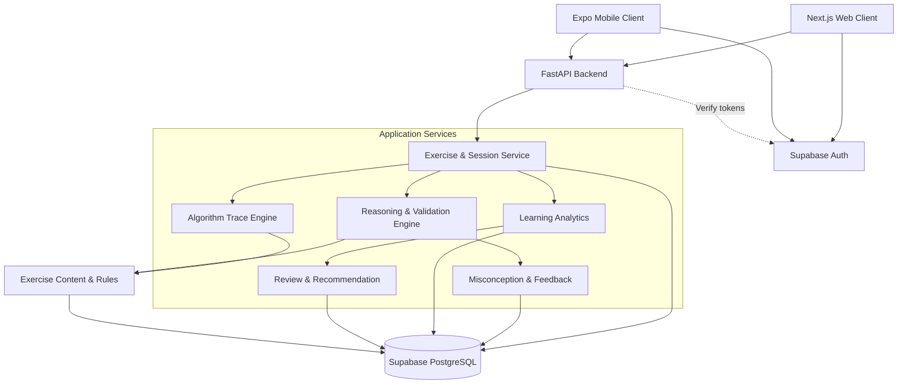
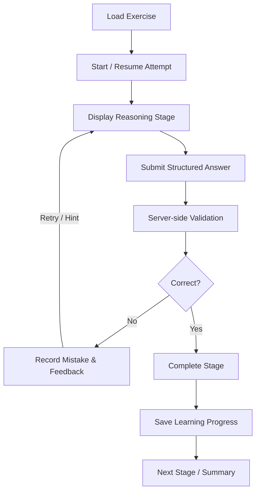

# AlgoBridge - Architecture Draft v0.3

**Status:** Proposed, unimplemented. Final technical decisions may change during development.  
**Baseline:** `docs/requirements/requirements.md`, `docs/requirements/MVP-scope.md`

This document describes the proposed system architecture, technology stack, main components, and data flow for AlgoBridge.  
The architecture focuses on reusing existing services and libraries and keeping the main development effort on the guided reasoning and learning features.

## Version History

| Version | Date | Changes |
|---|---|---|
| 0.1 | 2026-11-10 | initial logical architecture and proposed technology stack |
| 0.2 | 2026-11-13 | added Supabase Auth and hosted PostgreSQL; <br/>focused development on the FastAPI reasoning engine |
| 0.3 | 2026-11-25 | updated architecture for expanded learning features;<br/>added modular backend services, shared API design, and external service strategy |

---

## 1. Architecture Overview

AlgoBridge is a cross-platform educational application that helps students understand natural-language algorithm problems, identify important information, compare algorithm strategies, and construct solutions before coding.

The system consists of:

1. **Web Client:** Next.js application for learners and Admins.
2. **Mobile Client:** React Native / Expo application for Android and iOS learners.
3. **Backend API:** FastAPI application that handles learning sessions, answer validation, feedback, progress, and access control.
4. **Learning Engine:** Backend modules responsible for guided reasoning, misconception detection, algorithm comparison, and interactive algorithm traces.
5. **Authentication:** Supabase Auth for account registration, login, and session management.
6. **Database:** Supabase PostgreSQL for exercise content, versions, submissions, mistakes, and learning progress.

Web and Mobile use the same backend APIs and validation logic.  
The backend follows a **Modular Monolith** approach. Different learning features are separated into Python modules but remain inside one FastAPI application.  


## 2. Logical Architecture v0.3



### Main Design Decisions

- Web and Mobile share the same FastAPI backend.
- Supabase Auth manages authentication; FastAPI handles authorization and data ownership.
- Exercise content, validation rules, and learning history are stored in PostgreSQL.
- Correct-answer rules and unrevealed hints remain private on the server.
- The Reasoning Engine supports different structured activity types through predefined validators.
- Misconception Detection uses predefined rules rather than an LLM.
- Algorithm Visualization uses predefined or generated traces, not arbitrary student-code execution.
- Learning Analytics and planned review/recommendation features reuse existing submission records.
- No separate ML service, LLM service, or microservices are required for the MVP.

## 3. Application Components

### 3.1 Web Client

**Technology:** Next.js + TypeScript

The Web application provides:

- Exercise library and guided learning workspace.
- Structured answer controls and contextual feedback.
- Algorithm comparison and supported visualizations.
- Student learning dashboard.
- Login and account management.
- Basic Admin exercise-management interface.

The Web client uses existing UI component libraries where appropriate.  
It does not perform authoritative answer validation or contain private answer rules.

### 3.2 Mobile Client

**Technology:** React Native + Expo

The Mobile application provides the same core learner workflow as the Web application.

Mobile and Web share:

- Backend API endpoints.
- Exercise content and validation results.
- Student sessions and learning progress.
- API request/response types where practical.

UI layouts and visualization components may differ between platforms.  
The initial Mobile scope focuses on learner features. Admin content management remains Web-based.

### 3.3 FastAPI Backend

**Technology:** Python + FastAPI

The backend handles:

- Exercise and stage retrieval.
- Learning session management.
- Structured answer validation.
- Misconception classification and feedback.
- Hint access and stage progression.
- Algorithm trace generation.
- Learning progress and analytics.
- Admin content management.
- Authentication token verification and authorization.

The backend is organized into logical modules rather than separate services or deployments.

### 3.4 Exercise & Session Service

Responsible for:

- Loading published exercises and their versions.
- Starting and resuming exercise attempts.
- Managing reasoning stages and checkpoints.
- Checking stage access and completion.
- Recording submissions and hint usage.
- Handling predefined variant / transfer challenges.

Registered Students can save and resume their attempts across devices.

Guest practice uses temporary state and does not create permanent account learning history.

Existing attempts remain associated with the exercise version used when they started.

### 3.5 Reasoning & Validation Engine

This is one of AlgoBridge's main development components.  
It evaluates structured learner responses through predefined validators.

Supported activities may include:

- Single-choice and multiple-choice questions.
- Information extraction and classification.
- Parameter and variable matching.
- Structured problem modeling.
- Candidate algorithm comparison.
- Numeric and expression validation for supported formats.
- Pseudocode and algorithm-step activities.
- Intermediate-state prediction.

Each stage contains its own public configuration and private validation configuration.

The engine selects the appropriate validator based on the stage's response type.

The main validation logic is shared across exercises, so adding new content should not require rebuilding the learning workflow.

### 3.6 Misconception & Feedback Module

Responsible for identifying predefined common mistakes and returning appropriate feedback.

Examples include:

- Incorrect problem objective.
- Missing or misunderstood constraints.
- Confusion between parameters and variables.
- Incorrect algorithm selection.
- Misunderstood algorithm properties.
- Incorrect recurrence or state transitions.

The module uses structured responses and predefined diagnostic rules.  
When a specific mistake cannot be reliably identified, the system returns general feedback rather than guessing the learner's reasoning.  
Progressive hints are linked to reasoning stages and, where supported, misconception categories.

### 3.7 Algorithm Trace Engine

Responsible for generating and validating intermediate algorithm states for selected exercises.

Examples:

- DP table states for 0/1 Knapsack.
- Search or recursion steps for selected problems.
- Array or pointer updates for supported algorithms.

The engine generates structured trace data.  
Web and Mobile clients render the data using suitable UI components or visualization libraries.  
This separates algorithm logic from platform-specific visualization.  
Advanced side-by-side algorithm execution comparison is optional.

### 3.8 Learning Analytics Module

Responsible for generating basic performance information from saved Student learning records.

Initial indicators include:

- Completed and in-progress exercises.
- First-attempt correctness.
- Number of retries.
- Hint usage.
- Common misconception categories.
- Performance grouped by problem-solving skills.

Learning skills may include problem interpretation, problem modeling, algorithm selection, and solution formulation.  
Initial analytics use database queries and simple calculations. No predictive ML model is required.

### 3.9 Review & Recommendation Module (Should)

Planned after the main learning features are working.

**Selective Review:**

- Uses previous mistakes, hint usage, and learning performance.
- Suggests reasoning stages for review.
- Allows Students to manually change their review selection.
- Uses predefined rules rather than a trained adaptive-learning model.

**External Practice Recommendations:**

- Uses curated metadata for selected LeetCode or other online judge problems.
- Matches problem topics and skill tags with Student learning records.
- Returns relevant external practice links.

The system will not execute, submit, or grade code on external platforms.

## 4. Main Data Flow

### 4.1 Authentication

1. A Student registers or signs in through Supabase Auth.
2. Supabase manages the authentication session and issues access tokens.
3. Web or Mobile sends the token with protected FastAPI requests.
4. FastAPI verifies the token and checks the user's role and data ownership.
5. The backend processes authorized requests.

Guests can access published exercises without registration.  
Only authorized Admins can access content-management endpoints.

### 4.2 Guided Exercise Flow



The same validation workflow supports problem decomposition, algorithm comparison, solution construction, and other structured learning activities.  
For registered Students, submissions, mistakes, and progress are saved in the database.  
Hints are released according to the exercise rules and current stage state.

### 4.3 Interactive Visualization Flow

1. The learner reaches a supported visualization stage.
2. FastAPI loads the corresponding exercise configuration.
3. The Algorithm Trace Engine generates or retrieves the required trace data.
4. The client displays the current algorithm state.
5. The learner can predict intermediate results or explore the steps.
6. Answers are validated through the backend when required.

The backend controls which states and answers may be revealed at each stage.

### 4.4 Learning Analytics and Recommendations

1. The system records Student submissions, hints, and identified mistakes.
2. Learning Analytics calculates performance indicators by exercise and skill.
3. The dashboard displays learning history and basic performance summaries.
4. Planned review and recommendation features use the same records to suggest further practice.

No separate data analytics database or event-processing pipeline is required for the MVP.

## 5. Proposed Technology Stack v0.3

| Layer | Technology | Purpose |
|---|---|---|
| Web | Next.js + TypeScript | Learner and Admin interfaces |
| Mobile | React Native + Expo | Shared Android/iOS learner application |
| Backend | Python + FastAPI | API and learning logic |
| Authentication | Supabase Auth | User registration and login |
| Database | Supabase PostgreSQL | Exercise content and learning records |
| ORM / Migrations | SQLAlchemy + Alembic | Database operations and schema changes |
| API Types | FastAPI OpenAPI + TypeScript generation | Reduce duplicated Web/Mobile API definitions |
| UI Components | Existing React / React Native libraries | Reduce UI development time |
| Visualization | React components / SVG-based rendering | Display algorithm traces |
| Web Hosting | Vercel | Deploy Next.js |
| Backend Hosting | Python hosting (TBD) | Deploy FastAPI |
| Testing | pytest + frontend tests | Validation and integration testing |
| CI | GitHub Actions | Automated checks |
| Code Management | GitHub Monorepo | Source control and collaboration |

The technology stack remains proposed and may be adjusted based on implementation and hosting constraints.

## 6. External Services and Development Reuse

The project will use existing services and libraries where they reduce development work without replacing AlgoBridge's core learning logic.

| Function | Approach |
|---|---|
| Authentication | Supabase Auth SDK |
| Database hosting | Supabase PostgreSQL |
| API documentation | FastAPI OpenAPI |
| Shared API types | Generated TypeScript definitions |
| UI controls | Existing component libraries |
| Algorithm diagrams | Visualization libraries / SVG |
| Algorithm comparison | Internal predefined rules |
| Answer validation | Internal Reasoning Engine |
| Misconception detection | Internal diagnostic rules |
| Variant problems | Curated exercise configurations |
| Learning analytics | PostgreSQL queries and Python |
| Recommendations (Should) | Curated metadata and internal matching rules |

The project does not require an external LLM API for its core MVP.  
Using existing libraries for UI rendering does not replace the need to implement and test the underlying algorithm logic.

## 7. Data Design

The existing database design will be retained where possible.

### Existing Main Tables

- `TOPICS`
- `PROBLEMS`
- `PROBLEM_VERSIONS`
- `REASONING_STAGES`
- `EXERCISE_ATTEMPTS`
- `STAGE_SUBMISSIONS`
- `MISTAKE_TAGS`
- `SUBMISSION_MISTAKES`
- `STAGE_HINTS`
- `HINT_UNLOCKS`
- `PROBLEM_PUBLICATION_EVENTS`

The `REASONING_STAGES` table uses structured configuration fields to support different activity types and validators.  
Algorithm comparison activities and predefined variants may use the existing stage configuration and exercise versioning system rather than requiring separate tables.

### Proposed Updates

| Table / Area | Purpose |
|---|---|
| User profile / role records | Link application users to Supabase Auth identities without storing separate passwords |
| `SKILLS` | Define supported problem-solving skills |
| `STAGE_SKILLS` | Map reasoning stages to learning skills |
| Exercise / stage configuration | Support comparisons, variants, and visualization metadata |
| `EXTERNAL_PROBLEMS` (Should) | Store curated external practice metadata |
| Review preferences (Should) | Store selected review stages when persistent settings are needed |

Basic Learning Analytics can use the existing submission and hint records together with skill mappings.

Additional tables should only be introduced when they are needed for actual implementation.

Exercise answers, validation rules, and unrevealed hints must not be exposed through public APIs.

## 8. Backend API Design

Web and Mobile communicate with the same FastAPI backend using JSON-based HTTP APIs.

### Proposed API Groups

| Endpoint | Purpose |
|---|---|
| `GET /exercises` | List published exercises |
| `GET /exercises/{id}` | Retrieve public exercise information |
| `POST /attempts` | Start a saved Student attempt |
| `GET /attempts/{id}` | Resume an attempt and retrieve current progress |
| `POST /attempts/{id}/submissions` | Submit and validate a structured answer |
| `POST /attempts/{id}/hints` | Request the next available hint |
| `GET /attempts/{id}/trace` | Retrieve an authorized algorithm trace |
| `GET /me/progress` | Retrieve learning progress and basic analytics |
| `GET /me/review-plan` | Suggested review stages (Should) |
| `GET /me/recommendations` | External practice recommendations (Should) |
| `/admin/exercises/...` | Manage exercise content and publication |

Guest practice will use public exercise endpoints and a temporary practice validation flow without requiring a saved Student attempt.  
The final API structure will be decided during implementation.  
FastAPI will provide the API contract through OpenAPI. Generated TypeScript types can be shared between Web and Mobile to reduce duplicated interface definitions.

## 9. Proposed Repository Structure

The existing GitHub monorepo will be retained.

```text
AlgoBridge/
├── apps/
│   ├── web/                 # Next.js learner + admin
│   └── mobile/              # Expo learner app
│
├── backend/
│   ├── app/
│   │   ├── api/             # FastAPI routes
│   │   ├── services/        # Sessions, analytics, review
│   │   ├── engine/          # Validators and diagnostics
│   │   ├── algorithms/      # Trace generators
│   │   ├── models/          # Database models
│   │   └── schemas/         # Request/response models
│   └── tests/
│
├── content/
│   └── exercises/           # Curated exercise definitions
│
├── packages/                # Optional shared API types
│
└── docs/
    ├── project/
    ├── requirements/
    └── progress/
```

This is a proposed structure, not an implemented directory layout.  
The `packages/` folder may be introduced when shared TypeScript API types are needed.  
Backend modules can be simplified or combined if separate folders do not provide practical benefits.

## 10. Development Scope and Priorities

### Must — Core Architecture

- Web, Mobile, and shared FastAPI integration.
- Supabase Authentication and PostgreSQL.
- Exercise and session management.
- Reusable guided reasoning and answer validation.
- Misconception-aware feedback and progressive hints.
- Candidate algorithm comparison.
- Predefined variant / transfer activities.
- Interactive visualization for selected exercises.
- Basic progress tracking and learning analytics.
- Basic Admin content management.

### Should — After Core Integration

- Rule-based Selective / Personalized Review.
- Additional structured Code Construction.
- External practice recommendations.
- Shared generated API types where useful.

### Optional

- Advanced side-by-side algorithm visualization.
- Additional interaction and visualization types.
- More detailed learning analytics.

### Excluded

- AI-generated complete exercises.
- LLM Tutor / unrestricted AI feedback.
- Arbitrary student code execution or compilation.
- Online judge submission integration.
- ML-based adaptive-learning models.
- Microservices / distributed infrastructure.
- Production-scale deployment.

## 11. Implementation Plan

The first proof of concept will use **EX001 — 0/1 Knapsack**.

Initial implementation will focus on:

1. Loading a curated exercise and its reasoning stages.
2. Submitting structured answers through FastAPI.
3. Validating answers using predefined rules.
4. Returning feedback and selected misconception tags.
5. Unlocking subsequent stages and recording progress.
6. Demonstrating an interactive DP state trace.

After the first working flow, additional activities, exercise content, Student accounts, Web/Mobile integration, and analytics will be developed.  
A second exercise from another algorithm category should be used to test whether the same reasoning engine can support different problem-solving workflows.  
The project targets 12 curated exercises, with at least two demonstrating a deeper interactive learning experience.  
The internal integrated release target remains **2027-02-12**, subject to development progress and advisor feedback.

## 12. Main Changes from v0.2

- Keep Next.js, Expo, FastAPI, Supabase Auth, and PostgreSQL.
- Retain one FastAPI backend instead of introducing microservices.
- Separate reasoning, validation, misconception detection, visualization, and analytics into logical backend modules.
- Extend the existing exercise stage configuration to support new activity types.
- Add basic skill mappings for learning analytics.
- Reuse submission records for planned review and recommendation features.
- Use managed authentication, generated API types, and existing UI libraries to reduce development work.
- Keep authoritative validation and algorithm logic in the backend.
- Focus development on the reusable learning engine instead of building additional infrastructure.
