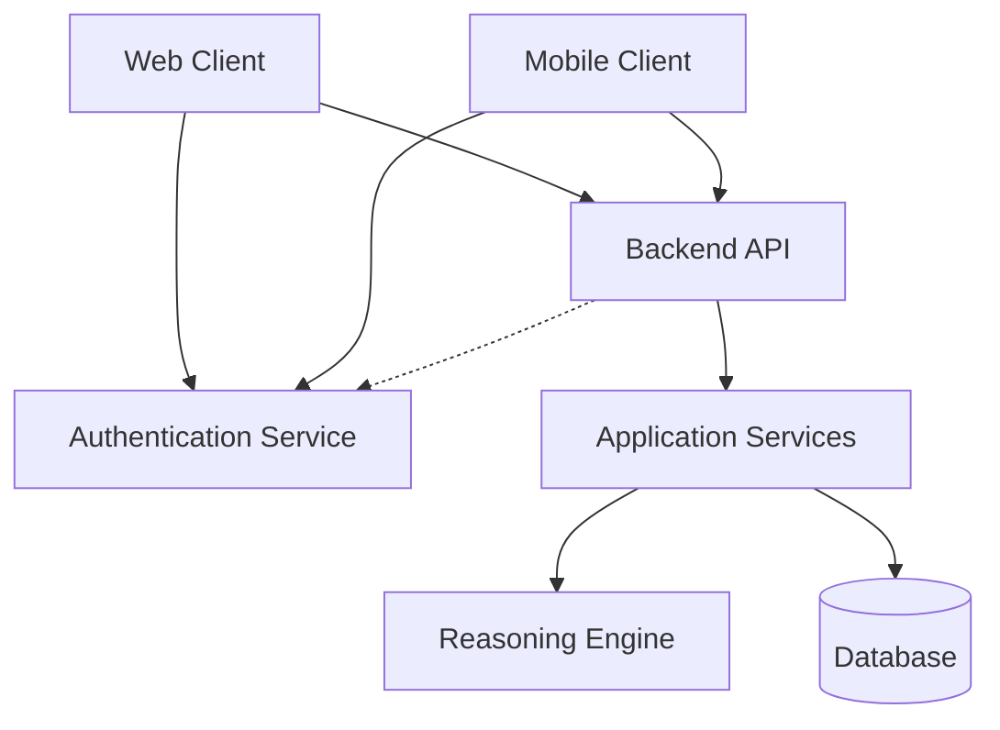
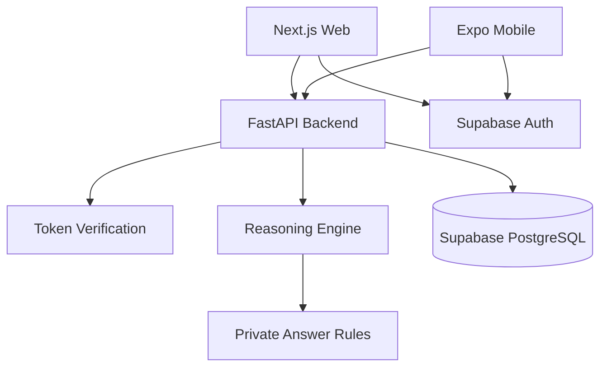

# AlgoBridge - Architecture Draft v0.2

**Status:** Proposed, unimplemented. Final technology choices require advisor/team confirmation.
**Basline:** `docs/requirements/requirements.md`

This doc describes the planned system architecture, tech stack, and main data flow.
Implementation details may change during development.

**version**
|version|date|changes|
|--|--|--|
|0.1|26-11-10|-|
|0.2|26-11-13|add architecture and tech stack v2 |

## Table of Contents

- [1.](#1-logical-architecture)
- [2.](#2-product-overview)
- [3.](#3-requirements)
- [4.](#4-verification)
- [5.](#5-appendixes)

## 1.1 logical architecture v1

- web and mobile share the same backend API
- backend handles exercises, answer checking, hints, progress, and accrss permissions
- authentication service manages user login
- backend verifies user identity before accessing protected data
- guests can practice w/o an account, but progress is not saved
- reasoning engine uses predefined rules, it doesn't execute any student-written code.

## 2.1 Proposed tech stack v1

Planned Tech Stack:

- web: Next.js, TypeScript
- mobile: React Native, Expo
- backend: Python, FastAPI
- database: PostgreSQL
- code Management: GitHub monorepo

| Layer | Candidate | Why |
|---|---|---|
| Web UI | Next.js + TypeScript | component model, routing, developer familiarity |
| Mobile UI | React Native + Expo | Android/iOS shared client stack |
| Backend | Python + FastAPI | testable rule engine, OpenAPI support |
| Persistence | PostgreSQL + migrations | relational integrity for users, attempts, content versions |
| Local dev | Docker Compose for DB | repeatable setup |
| Tests | pytest, frontend component tests, targeted E2E | regression protection |
| CI | GitHub Actions | fast feedback on PRs |

## 1.2 logical architecture v2

This version is focusing the team's own development on the reasoning engine using FastAPI.
- uses more Supabase for authentication and PostgreSQL hosting.
- no authentication infrastructure
- use existing UI components

## 2.2 Proposed tech stack v2
| Layer | Candidate | Why |
|---|---|---|
| Web UI | Next.js + TypeScript | component model, routing, developer familiarity |
| Mobile UI | React Native + Expo | Android/iOS shared client stack |
| Backend | Python + FastAPI | testable rule engine, OpenAPI support |
| Authentication | Supabase Auth | managed user registration and login |
| Database | Supabase PostgreSQL | hosted database for exercises and progress |
| ORM and migrations | SQLAlchemy + Alembic | database access and schema changes |
| Web hosting | Vercel | Next.js deployment |
| Backend hosting | Python hosting (TBD) | host the FastAPI application |
| Tests | pytest, frontend component tests, targeted E2E | regression protection |
| CI | GitHub Actions | fast feedback on PRs |

### Main diff
- Supabase Auth manages user accounts and login
- FastAPI handles application logic and permission checks
- PostgreSQL stores exercise content and student progress
- the reasoning engine checks answers using predefined rules
- web and mobile use the same API and validation logic

The stack is not final. Hosting and database connection details will be confirmed during development. *v2 is focusing on the core engine dev, proposed using more APIs for the system architecture*

