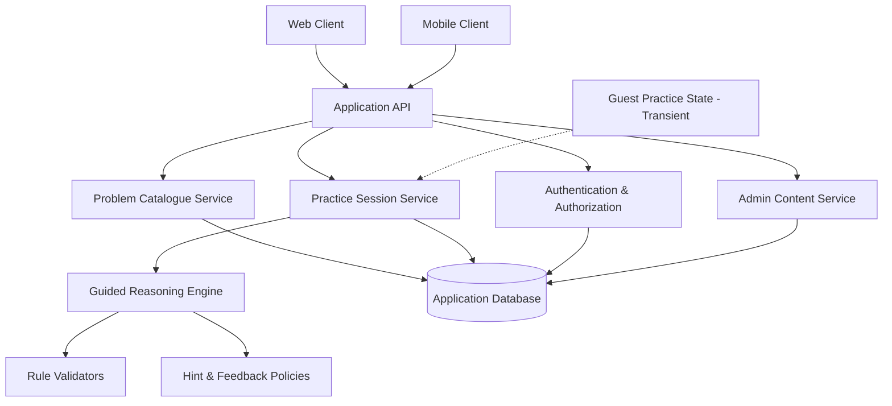

# AlgoBridge - Architecture Draft

**Status:** Proposed, unimplemented. Final technology choices require advisor/team confirmation.

## 1. Logical architecture

The mobile and Web clients are UI surfaces; the backend owns validation, progress and permissions.

Guest practice is available without authentication but must never gain access to another student's records or to hidden validation keys.
