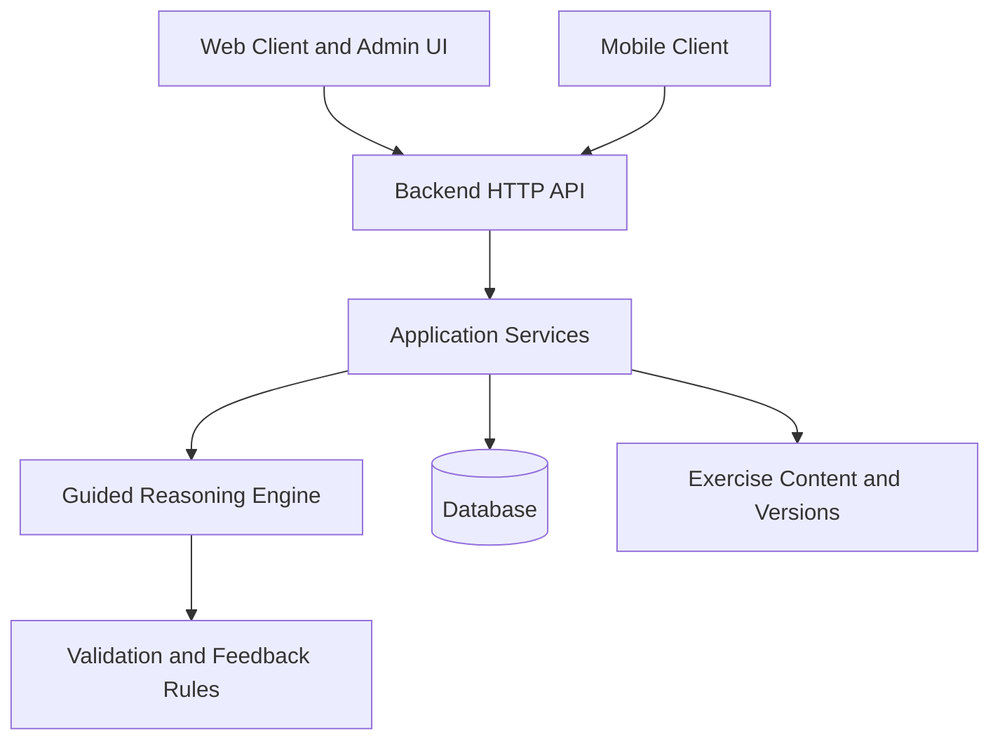

# AlgoBridge - Software Requirements Specification

**Version:** 0.1 (draft)  
**Prepared by:** Autumn and Aon  
**Organization:** Assumption University of Thailand - Senior Project 1  
**Date created:** 2026-11-10  
**Development target:** Integrated internal release by 2027-02-12

> **Document status:** This SRS is a draft for the proposed project and has not yet been approved by the advisor or put into practice. It brings together the project's previous proposal, scope, use cases, draft architecture, and initial Figma designs. The exercise target is **12 complete exercises, covering four algorithm categories with three exercises in each category**. The final exercise choices and development order will be decided after checking what is practical to complete.

## Table of Contents

- [1. Introduction](#1-introduction)
- [2. Product Overview](#2-product-overview)
- [3. Requirements](#3-requirements)
- [4. Verification](#4-verification)
- [5. Appendixes](#5-appendixes)

## Revision History

| Date       | Version | Changes                                                                                                                |
| ---------- | ------- | ---------------------------------------------------------------------------------------------------------------------- |
| 2026-11-09 | 0.1     | initial draft adapted from proposal;  requirements are written in "shall" format for mandatory system requirements |

## 1. Introduction

### 1.1 Document Purpose

This document describes the planned features, limitations, and testing criteria for AlgoBridge's MVP. It serves as a guide for the two-person team during development and helps with discussions with the project advisor, software testing, and preparation for the final defense. Requirements may be updated based on discussions and decisions made by the team and project advisor.

### 1.2 Product Scope

AlgoBridge is an educational platform that helps undergraduate Computer Science students practice **algorithmic problem-solving reasoning before coding**. Instead of executing or grading student programs, it presents selected algorithm problems as guided, structured reasoning stages, evaluates predefined answers, and provides contextual feedback and progressive hints.

The MVP targets **12 exercises distributed equally across four categories**: Divide and Conquer, Dynamic Programming, Greedy Algorithms, and Backtracking/Search (3 exercises in each category).

The product will have a Web client and a mobile client using the same backend. Guests can practice without registering, while registered students can save and resume progress. Admins can maintain the exercise catalogue through a content-management workflow.

**Out of MVP scope:** code execution/compilation, online judge integration, competitive contests, leaderboards, AI-generated feedback, free-text grading, adaptive recommendations, and complex algorithm animations.

### 1.3 Definitions

| Term                  | Definition                                                                                            |
| --------------------- | ----------------------------------------------------------------------------------------------------- |
| Exercise              | A selected algorithm problem containing a statement and a guided reasoning workflow.                  |
| Guest                 | A learner who uses the system without logging in. Their practice records are not saved to an account. |
| Hint                  | A prepared clue to help learners at a certain reasoning stage on request.                             |
| Reasoning stage       | One ordered checkpoint asking the learner to make a structured reasoning decision.                    |
| Rule-based validation | Checking a learner's structured answer with a set of predefined rules.                                |
| Session               | One attempt by a logged-in student to complete an exercise.                                           |

### 1.4 References

1. _AlgoBridge - Project Scope v1.0 (Working Baseline)_, Autumn and Aon, 2026-11-10, `docs/project/scope.md` (informative; superseded where this SRS changes scope).
2. _AlgoBridge - Core Use Cases v0.1_, Autumn and Aon, 2026-11-10, `docs/requirements/use-cases.md` (informative).
3. _AlgoBridge - Architecture Draft v0.1 (Monorepo)_, Autumn and Aon, 2026-11-10, `docs/design/architecture.md` (informative; proposed architecture).
4. _AlgoBridge proposal-stage Figma design_, Autumn and Aon, https://www.figma.com/design/q742RXyimnSC1U86bx9Sud/AlgoBridge---Copy?node-id=2001-324 (informative visual reference, not final implementation acceptance).

### 1.5 Document Overview

Section 2 summarizes the product, its users, and scope. Section 3 defines planned behavior and engineering constraints. Section 4 lists practical verification scenarios; Section 5 records exercise coverage and outstanding decisions. Requirements within each feature group are numbered sequentially. "Must" items define the intended MVP; "Should" items are desirable but may be deferred if necessary to meet the delivery deadline.

## 2. Product Overview

### 2.1 Product Perspective

AlgoBridge is a standalone educational application. It's not an extension of an existing online judge. Instead, it supports algorithm lectures and traditional programming exercises. Its main focus is to help students break down problems, choose suitable strategies, understand problem constraints, and build solutions step by step.

The planned system includes a Web application (with an admin interface), a mobile application, and a shared backend that includes a reasoning engine and database. The reasoning engine uses predefined rules to check students' answers.

The current Figma prototype already shows the reasoning workspace, feedback/hint components, a student dashboard, and admin screens; implementation may simplify or extend these designs during development.

### 2.2 Product Functions

1. Browse published exercises across four algorithm categories.
2. Start and complete a guided reasoning exercise as a Guest or Student.
3. Display ordered reasoning stages and structured answer options.
4. Check answers using predefined server-side rules, show feedback, and retry.
5. Provide hints progressively when requested.
6. Register/sign in and save or resume a Student's unfinished exercise.
7. Display a simple Student dashboard showing completed and in-progress work.
8. Allow authorized admins to manage and publish selected exercises while keeping different versions of exercise records.
9. Offer the same core learning workflow on web and mobile.

### 2.3 Product Constraints

- **Team:** The project is developed by two undergraduate students. The team will focus on making the main features work reliably before adding advanced features.
- **Time:** Complete integrated internal development by **2027-02-12**; later time is reserved for testing, report improvement, and demonstration preparation.
- **Content:** Creating and checking 12 complete exercise workflows will take considerable time. This work involves more than simply adding exercise data.
- **Assessment:** This is a Senior Project I software development project; the project advisor may suggest changes to the project scope during development.
- **Evaluation:** Structured, predefined answer checking only; the system does not need to run or execute arbitrary code written by students.
- **Platforms:** Web and Expo-based Android/iOS mobile app are planned; actual device testing coverage still needs to be decided.

### 2.4 User Characteristics

| User            | Expected usage                                   | Access                                                                                    |
| --------------- | ------------------------------------------------ | ----------------------------------------------------------------------------------------- |
| Guest           | Browse and complete exercises without an account | Published exercises, feedback, hints, and temporary practice only                         |
| Student/Learner | Practice regularly and keep track progress       | Guest features plus saved sessions, resume unfinished exercises, and a personal dashboard |
| Admin           | Manage and update content                        | Draft and published exercise management                                                   |

Learners are expected to have basic programming, data structure, and algorithms knowledge. The interface should use simple and clear language, show progress through each reasoning stage, and provide helpful feedback when learners make mistakes.

The MVP only support English language.

### 2.5 Assumptions and Dependencies

1. The team will prepare and check all exercise content, answer rules, feedback for common mistakes, and hints before publishing each exercise.
2. An internet connection is required to use the backend. The system does not support full offline use.
3. Both Web and mobile applications will use the same API.
4. The final 12 exercise titles and supported answer input types will be decided after discussing with the project advisor and completing an early proof of concept.
5. Guest practice may use temporary data stored on the device or limited data stored on the server.
6. The stack (Next.js, React Native/Expo, FastAPI, PostgreSQL) is **proposed**, not yet a confirmed implementation.

### 2.6 Apportioning of Requirements

| Release/phase               | Time                  | Planned coverage                                                                              |
| --------------------------- | --------------------- | --------------------------------------------------------------------------------------------- |
| Early proof of concept      | by 2026-12-06, target | One full reasoning flow using 0/1 Knapsack; backend validation and feedback through the Web   |
| Core engine development     | December-January      | Account management, main learner workflow, mobile integration, save/resume, content expansion |
| Feature-complete target     | 2027-01-31            | All Must requirements and 12 exercise configurations, subject to progress review              |
| Internal integrated release | 2027-02-12            | Tested Web/mobile workflows, consistent data, demonstration scenario and documentation        |
| Deferred/optional           | N/A                   | Advanced analytics, recommendation system, advanced exercise editing interface                |

> **Feasibility:** The current MVP target is 12 complete exercises, but this number may change depending on the actual workload and development progress. The time needed to create and check each exercise may also vary.

## 3. Requirements

### 3.1 External Interfaces

#### 3.1.1 User Interfaces

1. **Web learner interface:** landing page, exercise list, exercise overview, guided workspace, login/register, and progress dashboard.
2. **Mobile learner interface:** the same core exercise and progress workflows adapted for smaller screens; layout may differ from Web.
3. **Admin Web interface:** list and edit exercises, review draft before publishing, and publish/unpublish content.
4. **Guided workspace:** display the problem description, current reasoning stage, stage progress, answer controls, feedback, available hints, and exercise summary.
5. **Error states:** show messages for invalid input, failed requests, locked stages, and missing or unpublished exercises.

The existing Figma designs are visual references; implementation will prioritize features working as planned, not pixel-perfect design replication.

#### 3.1.2 Software Interfaces

1. Web and mobile apps shall communicate with a shared backend using JSON-based HTTP APIs.
2. Server responses shall only send exercise content that learners are allowed to see.; correct-answer rules and unrevealed hints shall remain private.
3. For requests from logged-in users, the server shall check user roles and data ownership before allowing access.
4. The backend shall store student exercise sessions, exercise versions, and content management data in a database.

No external AI services or third-party online judge integration are included.

### 3.2 Functions

The following are the **Must** requirements for the MVP unless labeled as **Should** (features develop after core flow).

#### 3.2.1 Accounts and roles

1. Guests shall be able to browse and start a published exercise without registration.
2. Guests shall be able to submit structured answers, request hints, and finish an exercise without saving progress to an account.
3. Users shall be able to register a Student account, sign in, and sign out.
4. Students shall access only their own saved sessions and progress.
5. Only an authorized Admins shall access content management features; Users shall not be able to register themselves as Admins through the public registration form.

#### 3.2.2 Exercise catalogue and coverage

1. The MVP shall provide 12 complete exercises: 3 in each of 4 categories (Divide and Conquer, Dynamic Programming, Greedy Algorithms, and Backtracking/Search).
2. Guests and Students shall be able to browse published exercises and filter them by algorithm category.
3. Each exercise shall display a title, topic, difficulty, problem statement, examples, and constraints.
4. Unpublished exercises shall not appear in the public catalogue.
5. **Should:** A keyword search may be added after category browsing is working properly.

For this requirement, an exercise counts as _complete_ only when it has reviewed content, a full guided stage sequence, working validation/feedback, appropriate hints, and tests on the shared backend.

#### 3.2.3 Guided reasoning and validation

1. Each published exercise shall provide an ordered sequence of reasoning stages. Different exercises may have different numbers of stages.
2. The system shall provide suitable answer input controls for each stage. The supported types for the MVP include single choice, multiple choice, structured selection, True or False, matching, and drag-and-drop when needed.
3. The server shall check submitted responses using predefined rules and return correct/incorrect feedback.
4. Incorrect responses shall allow retry without moving to the next stage.
5. When an answer is correct, the current stage shall be marked as complete and the next stage shall be unlocked.
6. The system shall provide prepared hints progressively when requested. The number of hints depends on exercises.
7. After the last stage, the system shall display a completion summary.
8. **Should:** More advanced answer checking, such as numeric and expression validation, and detailed statistics about common mistakes may be added after the main reasoning engine is working properly.

#### 3.2.4 Learning sessions and progress

1. Registered users shall be able to start a saved attempt associated with a specific exercise version.
2. The system shall save accepted submissions, stage completion, and hint usage for registered Students.
3. Students shall be able to resume an incomplete attempt after signing in on Web or mobile.
4. The dashboard shall display in-progress and completed exercises.
5. Students shall be able to start a new attempt for an exercise they have already completed. Each new attempt shall have its own progress and submission records.
6. Guest practice shall not save or appear as saved account history or offer cross-device resume.
7. Repeating an already accepted submission because of a network retry shall not create duplicate graded Student submissions.

#### 3.2.5 Admin content management

1. An Admins shall be able to create and edit draft exercises, including stages, answer rules, feedback, and hints.
2. The system shall check required exercise configuration before publication and reject incomplete drafts.
3. Admins shall be able to publish and unpublish exercises.
4. Each published exercise version shall have its own record, so previously saved Student attempts can still refer to the version used when they started.
5. **Should:** A visual editor for custom rules and admin analytics can be considered in a later phase. For MVP, predefined templates/configuration forms will be used.

#### 3.2.6 Cross-platform consistency

1. Web and mobile apps shall use the same backend for answer checking and published exercise content.
2. The same structured answer submitted for the same exercise version and stage shall receive the same validation outcome on both platforms.
3. A Student's saved stage and completion state shall remain the same when accessed from either client.

### 3.3 Quality of Service (TBD)

#### 3.3.1 Performance

#### 3.3.2 Security

#### 3.3.3 Reliability

### 3.4 Compliance (TBD)

### 3.5 Design and Implementation

#### 3.5.1 Installation

1. The team will provide instructions for setting up and running the Web, mobile, and backend components.
2. Database setup and sample exercise content shall be provided through documented commands.

#### 3.5.2 Build and Delivery

1. The source code and project documents will be stored in one GitHub repository.
2. The team will use Git for version control and regularly check code changes.
3. A working setup will be prepared for internal testing and the final demonstration.

#### 3.5.3 Maintainability

1. The system will keep the client interface, backend services, database operations, and reasoning logic in separate parts.
2. Adding a new exercise with existing stage and answer types should mainly require new content settings and tests, without changing the main answer-checking logic.
3. The team will provide basic documentation for the system design, setup, and testing.

#### 3.5.4 Portability

1. The Web interface supports commonly used desktop and mobile browsers.
2. The mobile app will target Android and iOS using one React Native/Expo codebase.
3. The team will test the applications on selected browsers, devices, and simulators.

#### 3.5.5 Cost

1. The team should use free/educational or open-source tools whenever possible.
2. Any paid services shall be discussed by the team before use. The project aims to avoid services with regular fees.

#### 3.5.6 Deadline (Tentative)

1. **2026-11-17**: present the scope, requirements, architecture proposal to the advisor.
2. **2026-12-06**: demonstrate a complete workflow connecting the web, backend, and reasoning engine.
3. **2027-01-31**: target main features completion, including 12 selected exercises.
4. **2027-02-12**: complete internal web/mobile/backend integration and prepare a draft report/demo.
5. The final submission and defense dates will follow the university schedule.

#### 3.5.7 Proof of Concept

The first proof of concept will use **0/1 Knapsack** to test one complete workflow: load a stage, submit a structured response, check answers on the server, display feedback, move to the next stage or retry, and show summary.

A second exercise from another algorithm category should also be tested early to check that the reasoning engine can support different types of exercises, not just Knapsack.

#### 3.5.8 Change Management

1. Changes to the project scope or requirements shall be recorded in the project documents or GitHub Issues.
2. Changes that affect the MVP deadline, the 12-exercise plan, supported answer types, or system architecture shall be discussed by the team and, when necessary, with the project advisor.
3. The SRS revision history will be updated when important requirements are changed.

## 4. Verification (TBD)

## 5. Appendixes

### Appendix A. Proposed 12-exercise content matrix

The following table shows the proposed 12 exercises for the MVP. The final exercise choices may change after discussion with the project advisor and review of the team's development workload.

| Category            | Exercise 1         | Exercise2                   | Exercise 3        |
| ------------------- | ------------------ | --------------------------- | ----------------- |
| Divide and Conquer  | Maximum Subarray   | Merge Sort                  | Binary Search     |
| Dynamic Programming | 0/1 Knapsack       | Coin Change (Minimum Coins) | Climbing Stairs   |
| Greedy Algorithms   | Activity Selection | Fractional Knapsack         | Interval Covering |
| Search              | Subset Sum         | Combination Sum             | N-Queens          |

Some exercises may have different versions or rules. These details must be clearly defined before creating their answer-checking rules.

### Appendix B. Proposed architecture summary

The following diagram shows the planned system structure and how its main components communicate.

**Planned Tech Stack:**

- **Web:** Next.js, TypeScript
- **Mobile:** React Native, Expo
- **Backend:** Python, FastAPI
- **Database:** PostgreSQL
- **Code Management:** GitHub monorepo

### Appendix C.
